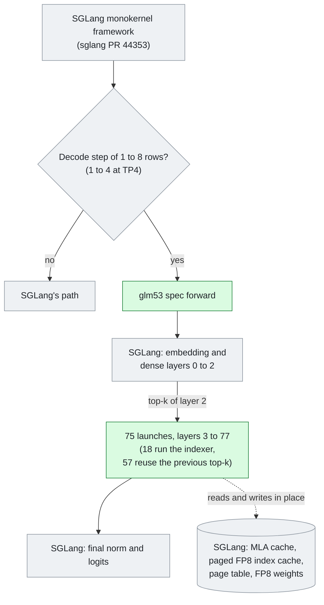

# #7 [Feat] [MI355X] glm53: Add GLM-5.3 decode monokernels
merged 2026-10-18T21:58:18Z a5ba84580 +7640/-2 files 20

## Motivation

On MI355X at TP8 with one request, a GLM-5.3 decode step on SGLang's path has a median TPOT of 11.2 ms. The model is the official `zai-org/GLM-5.3` (FP8 block-128). ROCm/aiter#6173 runs each GLM-5 decoder layer as one persistent FlyDSL launch. vllm-project/vllm#60831 integrates a variant of this kernel that keeps only MXFP4 experts.

This PR ports the aiter kernel to the `amd` monokernel backend of SGLang (RFC sgl-project/sglang#43949). It keeps the FP8 block-128 expert path that the official checkpoint needs. With `--monokernel-backend amd`, each MoE decoder layer of a covered decode step runs as one launch.

Result on MI355X:

- At TP8 with one request, the median TPOT decreases from 11.24 ms to 5.60 ms (2.01x).
- From 1 to 8 requests at TP8, the speedup is 1.38x to 2.18x. From 1 to 4 requests at TP4, it is 1.45x to 1.82x.
- Accuracy does not decrease. On AIME26 (30 problems x 8), pass@1 is 82.92% (off) and 86.67% (on). On GSM8K, it is 97.35% (off) and 97.27% (on).

Scope:

- GPU: MI355X (gfx950), at TP 4 or 8.
- Steps: decode steps of 1 to 8 rows (1 to 4 at TP4). All other steps use SGLang's path.
- Layers: the 75 MoE decoder layers 3 to 77. 18 launches run the indexer, and 57 reuse the previous top-k. The dense layers 0 to 2 use SGLang's path.
- SGLang: this PR needs sgl-project/sglang#44353 (merged as ec7ab9d0c2). It changes no SGLang file.
- Stack: this PR uses the three `common` fixes of #6, which has merged. Its diff now shows only GLM-5.3.

## Modifications

### How a decode step runs

Grey boxes are SGLang code, and this PR changes none of it. Green boxes are new in this PR.

One launch does these operations for one layer, in this sequence:

1. The input RMSNorm, the q_a and kv_a projections, the q_a RMSNorm, and q_b with RoPE.
2. The KV RMSNorm, the k_pe RoPE and the MLA cache write.
3. The indexer, on an indexer layer only:
   - the index K, Q and weight projections;
   - the index K norm, RoPE, Hadamard transform and cache write;
   - the index scores and the exact top-2048.

   A layer without an indexer reads the top-k of the layer before it.
4. The absorbed query (W_UK), the sparse MLA, W_UV and `o_proj`.
5. The attention TP all-reduce and the residual add.
6. The post-attention RMSNorm, the router in f32, and the FP8 quantization of the activations.
7. The top-8 selection and the experts: 1 shared and 8 routed, in FP8 block-128.
8. The MoE TP all-reduce and the residual add.

### Changes to SGLang (`python/sglang/srt`)

- None. This PR adds and changes files in sgl-amd-mono only.
- Without `--monokernel-backend amd`, SGLang runs as before. The spec registers for gfx950 only, so CUDA and other ROCm GPUs do not change.
- With the flag, SGLang calls the spec's forward, not `DeepseekV2ForCausalLM.forward`, for each decode step that the spec covers. SGLang still does the scheduling, the cache management, the sampling and all other steps.
- The plugin reads SGLang internals by name. Each module lists these names in `SGLANG_READS`. `test/unit/test_contract.py` checks them on CPU against the installed SGLang.
- At startup, the plugin uses more GPU memory. Thus the KV pool is 0.7% smaller at TP8 and 3.4% smaller at TP4 (see "Startup").

### Files

- `sgl_amd_mono/glm53/gfx950/`: the decoder-layer kernel from ROCm/aiter#6173 at 56d6390def. The first GLM-5.3 commit copies the files verbatim. The next commits adapt them:
  - Every wait runs under `common/guard.py` (deadline, peer flags, fail-stop).
  - The kernel reads SGLang's FP8 weights in place, in AITER's (16, 16) layout. These are the attention projections, the indexer projections and the experts. They include the two gate/up paths that load expert weights outside the shared unit.
  - The kernel reads SGLang's bf16 MLA cache, paged FP8 index cache and 64-token page table in place.
  - The page table and its stride are launch arguments, so each captured graph reads its own table.
  - Index keys and queries get the 128-point Hadamard transform after RoPE. SGLang's gfx950 fused indexer caches rotated keys, so the cache keeps one format. The spec refuses all other indexers, because they cache unrotated keys.
- `sgl_amd_mono/glm53/spec.py`: the spec and its forward. The forward is `DeepseekV2ForCausalLM.forward` for a covered decode step.
  - Layer 3 reuses the top-k of layer 2. The forward copies SGLang's indices into the compact buffer that the launch reads.
  - A step with fewer rows than a kernel width (2, 4 or 8) runs at the next width. One row runs at width 2, because a one-row launch does not complete on gfx950. The added rows are pad rows, and pad rows write no cache.
  - At TP4, a step of more than 4 rows uses SGLang's path. At TP4, an 8-row launch is slower than SGLang's path: TPOT 18.15 ms against 16.95 ms at 8192 / 256 and c8.
  - The spec refuses unsupported setups at startup and gives the reasons. Some examples:
    - another checkpoint format, page size, KV dtype or MoE runner;
    - an unfused shared expert;
    - FP8 projections outside AITER's (16, 16) layout, for example with `--fp8-gemm-backend triton`;
    - experts that do not use the AITER MoE runner;
    - an indexer other than SGLang's gfx950 fused indexer.
- Weight copies:
  - W_UK and W_UV, packed from SGLang's per-tensor FP8 `w_kc` and `w_vc` (the same values that SGLang multiplies by);
  - the router and the indexer's `weights_proj`, packed for the MFMA tiles;
  - the indexer's k LayerNorm in f32;
  - one bf16 rotary table.
- `sgl_amd_mono/glm53/check.py`: with `SGLANG_AMD_MONO_CHECK=1` (eager mode only), each covered layer also runs SGLang's layer on the same input and caches. The check compares the stream, the MLA KV row and the index keys (after dequantization) with the bounds in `NUMERICS`.
- Registration in `sgl_amd_mono/__init__.py`, a README row, a NOTICE entry, and these tests:
  - `test/unit/test_glm53_spec.py` (CPU)
  - `test/e2e/test_glm53_server.py` (TP8)
- There is no random-weight launch test like the one for glm53_flash. The e2e check compares each covered layer with SGLang's layer on the real weights. The cost is that the test needs the checkpoint.

### Routing numerics

- The kernel routes in f32, as the model defines it: sigmoid plus correction bias for the choice, and sigmoid for the weights.
- SGLang's AITER top-k casts the correction bias of GLM-5.3 (approximately 34) to bf16. Thus SGLang's choice and weights are different from f32 routing.
- For this reason, the check mode routes SGLang's reference layer in f32.

### Not in this PR

- An FP8 KV cache.
- Speculative decoding (MTP).
- MXFP4 checkpoints.
- Decode steps of more than 8 rows (4 at TP4).

## Accuracy Tests

Setup (also for the speed tests):

- Hardware: one node with 8 x MI355X (gfx950).
- Image: `rocm/sgl-dev:v0.5.21-rocm10-mi35x-20261014` (`sha256:e4498f5d595f`), with ROCm 10.0.0, torch 2.11.0, FlyDSL 0.3.4.1 and AITER e7d2453f.
- SGLang: main at 4cca7fcd3e.
- sgl-amd-mono: this PR. The TP8 runs are older than two commits, and neither commit changes what TP8 launches:
  - cbc8f15 adds the TP4 row cap.
  - 02d42fa adds the review fixes: startup refusals, the rotary check over each indexer, msgspec config containers, comments and notices.
  - The e2e tests ran again on 02d42fa (see the end).
- Model: `zai-org/GLM-5.3` at ba32f8c19c (FP8 block-128).
- Server: the cookbook's AMD recipe (TP8, TileLang DSA prefill and decode, `--chunked-prefill-size 131072`, no MTP), with `--mem-fraction-static 0.80`, `--max-running-requests 96` and `--cuda-graph-max-bs-decode 96`. SGLang selects the bf16 KV cache, 64-token pages and the AITER MoE runner. TP4 is not a cookbook cell, and it uses the same flags.
- The only difference between the arms is `--monokernel-backend amd`. Each arm runs on a fresh server.
- Evals: sgl-eval 0.1.2 at TP8, with 8 or fewer requests at a time.

| Eval | Settings | Monokernels off | Monokernels on |
| --- | --- | --- | --- |
| GSM8K (1,319) | thinking, T 1.0, top-p 0.95, seed 42 | 97.35% | 97.27% (10 vs 11 discordant, exact McNemar p = 1.00) |
| AIME25 (30 x 4 seeds) | thinking, T 0.6, top-p 0.95, 65,536 tokens | 90.00% | 89.17% (-0.83 points, bootstrap 95% CI [-5.8, +4.2] over problems; 2 better, 4 worse; sign test p = 0.69) |
| RULER2 NIAH at 1M tokens (4 subtasks x 2) | no thinking, greedy, 256 tokens | 31.56% | 25.60% |

- AIME25: 11 answers (off) and 13 answers (on) reached the token limit. The median length was 7,630 tokens (off) and 9,351 tokens (on). For each problem, the monokernels ran longer on 17 problems and shorter on 12 (sign test p = 0.46).
- NIAH: `mk_niah_basic` scores 100 in both arms. Most other answers reached the 256-token limit (4 of 8 samples off, 6 of 8 on). The reasoning lists the needles, and the limit stops the answer. Thus the multi-value subtasks mostly measure where the answer stops.
- The arms also use different routing precision: f32 (on) and SGLang's bf16 correction bias (off). See "Routing numerics".

Per layer, against SGLang's own layer on the same input and caches:

- Setup: `SGLANG_AMD_MONO_CHECK=1`, eager mode. Batches of 1, 3 and 8 rows. Positions up to 2.4k. 1,425 checks for each TP size.
- Result: no value is outside its bound.
- The TP4 run is older than the TP4 row cap, so it also covers 8-row launches.

| Output | TP4 | TP8 |
| --- | --- | --- |
| written stream, cosine | >= 0.9916 | >= 0.9938 |
| MLA KV row, cosine | >= 0.9996 | >= 0.9995 |
| index keys after dequantization, cosine | >= 0.99993 | >= 0.99994 |

Decode against prefill (`sglang.test.kl_test_utils`, 512 tokens, mean KL for each batch):

- 0.009, 0.017, 0.016 and 0.030 for batches of 2, 3, 7 and 8 rows.
- The bound is 0.06.

### AIME26 on 02d42fa

GSM8K is near its ceiling for this model, so it finds only large errors. The SGLang contribution guide asks for a harder eval, and the GLM-5.3 cookbook reports AIME25 and AIME26. Thus this PR also reports AIME26 on its final head.

- Setup: MI355X, TP8, SGLang main 4cca7fcd3e, sgl-amd-mono 02d42fa, sgl-eval 0.1.3 (the version that SGLang pins). Each arm used a fresh server.
- 8 or fewer requests ran at a time, so each decode step of the "on" arm ran the launches.
- Generation: thinking, T 1.0 and top-p 0.95 (the recommended settings of the model), 65,536 max tokens.

| AIME26 (30 problems x 8) | Monokernels off | Monokernels on |
| --- | --- | --- |
| pass@1 | 82.92% | 86.67% |
| majority@8 | 96.67% | 96.67% |
| samples at the token limit | 34 of 240 | 29 of 240 |
| median output tokens | 12,197 | 11,492 |

- Paired over the 30 problems, the "on" arm is 3.75 points higher (bootstrap 95% CI [-1.2, +9.6]). 7 problems are better, 5 are worse and 18 are tied (sign test p = 0.77). The difference is within noise.
- 12% to 14% of the samples reach the 65,536-token limit. Thus these scores are lower than scores with a larger limit, and you cannot compare them with the cookbook numbers. Both arms use the same limit.
- The arms also use different routing precision (see "Routing numerics").

## Speed Tests and Profiling

Method:

- The setup is the same as for the accuracy tests.
- Workload: `sglang.bench_serving` with the random dataset at fixed lengths (8192 in and 256 out, 512 in and 128 out). Each concurrency c uses max(16, 4c) prompts after a warmup.
- Each arm runs on a fresh server, in two rounds. The second round swaps the arm order. TP4 also swaps the GPU set.
- At load, each server checks that no other process holds memory on its GPUs.
- The tables give the median TPOT per request over both rounds, with a bootstrap 95% CI.

TP8 (GPUs 0-7):

| Shape | c | Monokernels off (ms) | Monokernels on (ms) | Speedup |
| --- | --- | --- | --- | --- |
| 8192 / 256 | 1 | 11.24 [11.23, 11.24] | 5.60 [5.60, 5.60] | 2.01x |
| 8192 / 256 | 2 | 12.36 [12.35, 12.37] | 5.78 [5.77, 5.78] | 2.14x |
| 8192 / 256 | 4 | 13.30 [13.29, 13.31] | 7.33 [7.32, 7.34] | 1.81x |
| 8192 / 256 | 8 | 15.85 [15.81, 17.80] | 11.51 [11.49, 13.47] | 1.38x |
| 8192 / 256 | 16 | 18.65 [18.65, 22.51] | 18.94 [18.91, 22.53] | 0.98x |
| 512 / 128 | 1 | 10.79 [10.79, 10.79] | 5.43 [5.43, 5.44] | 1.99x |
| 512 / 128 | 2 | 11.95 [11.93, 11.97] | 5.48 [5.47, 5.48] | 2.18x |
| 512 / 128 | 4 | 12.81 [12.81, 12.83] | 6.86 [6.85, 6.86] | 1.87x |
| 512 / 128 | 8 | 15.41 [15.40, 15.41] | 10.93 [10.91, 10.95] | 1.41x |
| 512 / 128 | 16 | 17.71 [17.68, 17.73] | 17.68 [17.66, 17.70] | 1.00x |

- At c16, a step has more than 8 rows, so both arms use SGLang's path. The 16-row decode steps take the same time in both arms (median ITL 18.6 ms at 8192 / 256).
- The 8192 / 256 c16 TPOT is different because of the scheduler. It admitted one burst of prefix-cached prompts as 1 + 10 + 5 requests, not as 1 + 15. This stops approximately 10 running requests once, for approximately 0.1 s.

TP4 (round 1 on GPUs 0-3, round 2 on GPUs 4-7):

| Shape | c | Monokernels off (ms) | Monokernels on (ms) | Speedup |
| --- | --- | --- | --- | --- |
| 8192 / 256 | 1 | 12.02 [11.99, 12.04] | 7.09 [7.09, 7.10] | 1.70x |
| 8192 / 256 | 2 | 13.05 [13.04, 13.06] | 7.25 [7.24, 7.26] | 1.80x |
| 8192 / 256 | 4 | 14.68 [14.65, 14.70] | 10.10 [10.08, 10.11] | 1.45x |
| 8192 / 256 | 8 | 16.96 [16.93, 19.52] | 16.95 [16.93, 19.51] | 1.00x |
| 8192 / 256 | 16 | 23.19 [23.17, 27.96] | 23.17 [23.06, 27.95] | 1.00x |
| 512 / 128 | 1 | 11.61 [11.58, 11.64] | 6.95 [6.95, 6.95] | 1.67x |
| 512 / 128 | 2 | 12.63 [12.61, 12.65] | 6.94 [6.94, 6.95] | 1.82x |
| 512 / 128 | 4 | 14.33 [14.31, 14.34] | 9.70 [9.68, 9.71] | 1.48x |
| 512 / 128 | 8 | 16.74 [16.71, 16.75] | 16.73 [16.68, 16.75] | 1.00x |
| 512 / 128 | 16 | 22.26 [22.20, 22.29] | 22.22 [22.18, 22.23] | 1.00x |

- At c8 and c16, a TP4 step has more than 4 rows, so both arms use SGLang's path.
- Before the TP4 row cap, the 8-row launches made c8 slower:
  - 8192 / 256: 18.15 ms against 16.95 ms (0.93x).
  - 512 / 128: 17.44 ms against 16.76 ms (0.96x).

### Cookbook shape on 02d42fa

The GLM-5.3 cookbook reports speed at random 8192 in / 1024 out. This table uses that shape at TP8 on 02d42fa.

- Each arm ran on a fresh server, in two rounds. The second round swapped the arm order.
- TPOT is the median per request over both rounds, with a bootstrap 95% CI. TTFT is the median per request. Throughput is the mean over the rounds.

| Conc. | TPOT off (ms) | TPOT on (ms) | Speedup | TTFT off / on (ms) | Output tok/s per GPU off / on |
| --- | --- | --- | --- | --- | --- |
| 1 | 11.24 [11.24, 11.24] | 5.58 [5.58, 5.59] | 2.01x | 541 / 540 | 10.6 / 20.2 |
| 2 | 12.34 [12.33, 12.35] | 5.75 [5.75, 5.76] | 2.15x | 287 / 285 | 19.7 / 40.9 |
| 4 | 13.27 [13.25, 13.28] | 7.28 [7.28, 7.29] | 1.82x | 365 / 353 | 31.3 / 49.7 |
| 8 | 15.80 [15.79, 16.26] | 11.44 [11.42, 11.89] | 1.38x | 3,067 / 3,059 | 49.1 / 62.5 |
| 16 | 18.62 [18.60, 19.51] | 18.60 [18.60, 19.51] | 1.00x | 1,080 / 1,037 | 86.7 / 87.0 |

At 16 requests, a step has more than 8 rows, so both arms use SGLang's path.

Profile (torch profiler, rank 0, TP8, one request, mean of 10 decode steps):

- SGLang's path: a decode step runs 1,821 GPU kernels in 11.70 ms of GPU time.
- Monokernels on: a decode step runs 212 kernels in 5.59 ms. The 75 launches use 4.76 ms (63.5 us each). The other 137 kernels (0.83 ms) are the embedding, the dense layers 0 to 2, the final norm and the logits.

Startup:

- In a new container, the kernels build in approximately 40 s at TP8 (6 kernels) and 30 s at TP4 (4 kernels).
- A later server in the same container builds them in approximately 2 s, because the container keeps the compiled code objects (`~/.cache/comgr`).
- During the build, PyTorch memory increases by 511.8 MiB for each GPU at TP8 and by 573.1 MiB at TP4.
- The weight copies are 491 MiB at TP8 and 622 MiB at TP4:
  - W_UK / W_UV: 131 or 263 MiB;
  - the router: 225 MiB;
  - the rotary tables: 128 MiB;
  - `weights_proj`: 7 MiB.
- The peer buffers are outside PyTorch.
- In total, the KV pool decreases by 0.7% at TP8 (from 1,533,824 to 1,522,624 tokens). At TP4, it decreases by 3.4% (from 539,584 to 521,024 tokens).

Tests on MI355X in the image above, with SGLang main at 4cca7fcd3e:

- unit (CPU): 88 passed on 02d42fa, with SGLang main 4cca7fcd3e and 2948662026. Two of the cases fail on cbc8f15: the layout and indexer refusals, and the rotary check over each indexer.
- e2e (TP8): 4 passed on 02d42fa in one run:
  - GSM8K-200 through the launches: 0.995.
  - KL: 0.036, 0.025, 0.018 and 0.021 for batches of 2, 3, 7 and 8 rows.
  - The check mode: all values are within `NUMERICS`.
  - An injected wait fault stops all ranks, and the faults are only at address 0x0.
- The lowest stream cosine of the check mode changes between runs, on one row. It was 0.9938 and 0.9939 in the earlier runs, and 0.9895 (layer 31, position 30) on 02d42fa. All other checks are 0.994 or more.

The kernel comes from ROCm/aiter#6173 at 56d6390def (Apache-2.0, FlyDSL Project Contributors). The file headers are kept. vllm-project/vllm#60831 integrates the MXFP4 variant.

### Review fixes (on top of 02d42fa)

- main is merged in (#6 with its review fixes, and #10).
- New startup refusals:
  - unfused DSA top-k (`SGLANG_DSA_FUSE_TOPK=0`). With it, layer 2 hands layer 3 request-local positions instead of KV slots, and layers 3 to 5 would attend other requests' rows.
  - `--enable-hisparse`, whose logical KV slots the kernels write raw.
  - `--expert-distribution-recorder-mode`.
  - SGLang's benchmark routing overrides.
  - a scaled RoPE such as YaRN. SGLang scales the softmax by mscale squared, while the kernel's scale is fixed.
  - an f32 router gate that bf16 cannot hold exactly.
  - a served context longer than the copied rotary table.
  - a TP4 server whose decode graphs all exceed the 4-row cap.
- The kernel cache key holds the sources digest, as GLM-5.3-Flash's and DeepSeek-V4.1's do. So an edit to `common/`, or to an aiter helper the kernel imports, rebuilds it.
- `SGLANG_READS` declares every SGLang name that the spec reads.
- Cleanup:
  - the lineage comments are gone;
  - the stale kernel and runner docstrings match the code;
  - the guard flags size uses `common.guard.FLAG_BYTES`;
  - a few names are clearer, and `gfx950/` has a package `__init__`.
- CODEOWNERS adds `**/*glm53* @jhinpan`, above the Flash line, because the last match wins.
- The README has the GLM-5.3 row and its own test command.
- Tests on a470273:
  - `test/unit`: 89 passed, with SGLang main 4eb606b2ae and sgl-project/sglang#44601.
  - pre-commit passes.
  - Not executed: the TP8 e2e. It needs 8 x MI355X and the zai-org/GLM-5.3 checkpoint.

## Checklist

- [x] `pre-commit run --all-files` passes.
- [x] Tests under `test/` cover the change.
- [x] The SGLang commit or PR this was tested against is named above.
- [x] Accuracy and speed results are attached when kernel or forward code changes.

## Review and Merge Process

1. The `lint` and `Check PR title` checks must pass.
2. Ask a code owner from `.github/CODEOWNERS` to review.
3. Merge with "Squash and merge": the PR title becomes the commit title on `main`.

